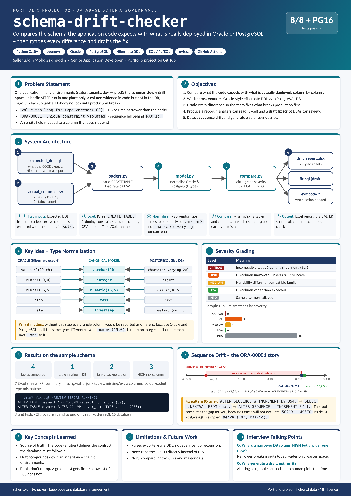

# schema-drift-checker


| [How to use](docs/USAGE.md) | [Design document](docs/DESIGN.md) | [Poster (PDF, A3)](docs/poster.pdf) | [Changelog](CHANGELOG.md) |
|---|---|---|---|

<a href="docs/poster.png"></a>

Compare the schema your **application code expects** (Hibernate / JPA DDL export, or any `CREATE TABLE` script)
against what is **actually deployed** in an Oracle or PostgreSQL database, and get a styled Excel report plus a
draft remediation script.

## The problem

When one application is deployed to several environments (states, tenants, dev/staging/prod), the database
schemas slowly drift apart: a hotfix ALTER that only ran in one place, a column widened in the code but never in
the database, backup tables nobody cleaned up. The first sign is usually a production error:

- `value too long for type character varying(100)` - the DB column is narrower than the entity says
- `ORA-00001: unique constraint violated` - a sequence fell behind `MAX(id)`
- an entity field that maps to a column that does not exist

I do this kind of check regularly at work across Oracle and PostgreSQL environments. This repo is a clean,
generic rebuild of that workflow. *All table names and data here are fictional.*

## What it reports

| Sheet | Meaning |
|---|---|
| KPI Summary | counts per category and an overall CLEAN / ACTION NEEDED status |
| Expected-Only Tables | in the code, missing in the DB |
| DB-Only Tables | in the DB, not in the code (undocumented) |
| Junk Tables | `*_bak`, `tmp_*`, date-stamped copies |
| Missing / Extra Columns | column-level differences |
| Type Mismatches | graded **CRITICAL / HIGH / MEDIUM / LOW / INFO** |

Severity logic:

- **CRITICAL** - incompatible type families (e.g. `varchar` vs `numeric`)
- **HIGH** - DB column is *narrower* than expected (inserts will fail or truncate)
- **MEDIUM** - nullability differs, or compatible-but-different families (`varchar` vs `text`)
- **LOW** - DB column is wider than expected
- **INFO** - identical after normalisation (`varchar2(20 char)` == `character varying(20)`, `number(19,0)` == `bigint`)

Oracle and PostgreSQL type names are normalised to one model first, so a Hibernate export written with the Oracle
dialect can be compared directly with a PostgreSQL database.

## Usage

```bash
pip install -e ".[dev]"

# 1. export the live schema (queries in sql/), then:
schema-drift compare \
  --ddl examples/expected_ddl.sql \
  --catalog examples/actual_columns.csv \
  --out drift_report.xlsx \
  --fix-sql fix.sql --dialect postgres
```

```
Compared 4 tables -> drift_report.xlsx
  missing tables: 1  undocumented tables: 1  junk: 2
  missing columns: 1  extra columns: 1
  mismatches: CRITICAL=0, HIGH=3, MEDIUM=1, LOW=0, INFO=13
STATUS: ACTION NEEDED
```

Exit code is `2` when action is needed, so it can run as a scheduled or CI check.

### Sequence drift

```bash
# sequence_states.csv comes from sql/sequence_drift_oracle.sql or sql/sequence_drift_postgres.sql
schema-drift sequences --states examples/sequence_states.csv --dialect oracle
```

```sql
-- seq_application: last_number=49870, MAX(id) in application=50213
ALTER SEQUENCE seq_application INCREMENT BY 354;
SELECT seq_application.NEXTVAL FROM dual;
ALTER SEQUENCE seq_application INCREMENT BY 1;
```

The increment is written as a **literal** on purpose: Oracle does not evaluate arithmetic inside DDL, so
`INCREMENT BY 50213 - 49870` fails with ORA-01722.

## Tested against a real database

CI loads a deliberately drifted PostgreSQL 16 database (`examples/demo_postgres.sql`), exports its catalog with the
shipped query, compares it, finds the drifted sequence, applies the generated fix and proves the next insert succeeds.

## Project layout

```
schemadrift/
  model.py      Column/Table model + Oracle<->PostgreSQL type normalisation
  loaders.py    CREATE TABLE parser and catalog CSV loader
  compare.py    diff + severity grading + draft fix script
  excel.py      openpyxl report (frozen headers, filters, severity colours)
  sequences.py  sequence drift detection and resync scripts
sql/            catalog export and sequence drift queries for Oracle and PostgreSQL
examples/       fictional sample inputs and the generated sample report
```

## Limitations

- The DDL parser targets the `CREATE TABLE` style produced by schema exporters, not every vendor extension.
- The generated fix script is a **draft** - always review it; widening a column can lock a large table.

## License

MIT
