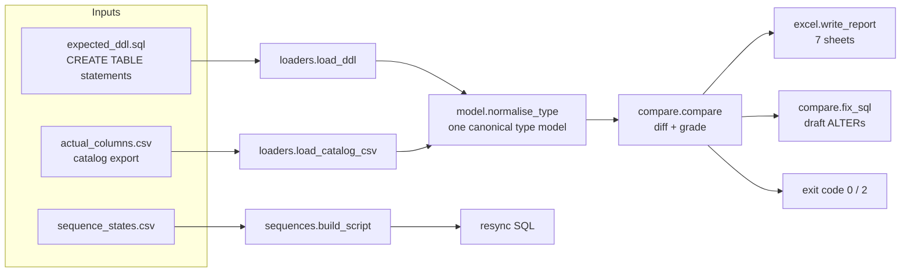
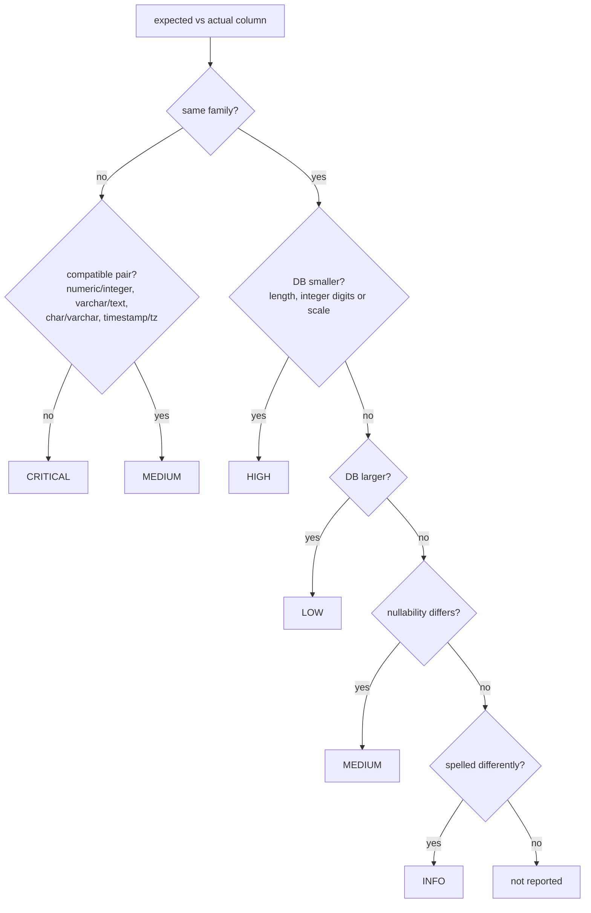

# schema-drift-checker: Design document

| | |
|---|---|
| Author | Sallehuddin Mohd Zakinuddin |
| Status | v1.0.0 implemented |
| Last updated | November 2026 |

## 1. Context

One Java/Hibernate application is deployed as many copies: one per client, each with dev, test, staging and
production databases, some on Oracle and some on PostgreSQL. Each copy receives the same code but its database is
changed by hand-run patches. Over time the copies drift:

- a hotfix `ALTER` that only ran in one environment,
- a column widened in the entity but never in the database,
- backup tables (`payment_bak_20240115`) nobody removed,
- sequences that fall behind `MAX(id)` after a data load.

Drift is invisible until production fails (`value too long`, `ORA-00001`, missing column). Checking it by hand means
comparing hundreds of tables by eye. This tool makes the comparison repeatable and ranks what it finds.

## 2. Goals and non-goals

**Goals**

1. Compare an expected schema (DDL from the code) with a live catalog, table by table and column by column.
2. Compare across vendors: Oracle-flavoured Hibernate DDL against a PostgreSQL database must work.
3. Grade every difference by production risk.
4. Produce a report a team lead can read (Excel) and a draft fix a DBA can review (SQL).
5. Detect and fix sequence drift.

**Non-goals**

- Applying changes automatically.
- Comparing indexes, triggers, grants or data (future work).
- Replacing migration tools such as Flyway or Liquibase.

## 3. Architecture

### Components

| Module | Responsibility |
|---|---|
| `model.py` | `Column` and `Table` dataclasses and `normalise_type`, which maps vendor type names to one family plus length, precision and scale |
| `loaders.py` | `load_ddl` parses `CREATE TABLE` bodies, splitting on top-level commas and skipping constraint clauses. `load_catalog_csv` reads the export with case-insensitive headers |
| `compare.py` | Set differences for tables and columns, junk-table detection, `grade` for each shared column, draft `fix_sql` |
| `excel.py` | Styled workbook: frozen header, filters, banded rows, severity colours |
| `sequences.py` | `SequenceState`, gap calculation, Oracle three-step and PostgreSQL `setval` scripts |
| `cli.py` | `compare` and `sequences` subcommands |

## 4. Type normalisation

| Raw type | Family | Kept attributes |
|---|---|---|
| `varchar2(20 char)`, `nvarchar2(20)`, `character varying(20)` | `varchar` | length 20 |
| `number(19,0)`, `bigint`, `integer`, `int8` | `integer` | (precision for Oracle) |
| `number(16,5)`, `numeric(16,5)`, `decimal(16,5)` | `numeric` | precision 16, scale 5 |
| `clob`, `long`, `text` | `text` | none |
| `date`, `timestamp`, `timestamp without time zone` | `timestamp` | none |
| `blob`, `raw`, `bytea` | `binary` | none |

`number(p,0)` becomes `integer` because Hibernate maps Java `Long`/`Integer` to it, and the PostgreSQL side uses
`bigint`. Oracle `DATE` carries a time part, so it maps to `timestamp`, not `date`.

## 5. Severity model

Ranking reflects what breaks first in production. A smaller DB column rejects or truncates real input today, so it is
HIGH. A larger one only wastes space, so it is LOW.

## 6. Sequence drift

A sequence drifts when its next value is at or below the largest id already in the table. The next insert then
collides with an existing primary key.

- **Gap** = `MAX(id) - last_value + 1`. The script adds a buffer of 10.
- **Oracle:** `ALTER SEQUENCE s INCREMENT BY <gap>` → `SELECT s.NEXTVAL FROM dual` → `ALTER SEQUENCE s INCREMENT BY 1`.
  The gap is written as a literal because Oracle DDL does not evaluate arithmetic (`50213 - 49870` fails with ORA-01722).
- **PostgreSQL:** `SELECT setval('s', (SELECT MAX(id) FROM t))`.
- The Python check uses `last_value <= MAX(id)`, which is conservative for Oracle, where `last_number` can run ahead
  because of caching. The PostgreSQL query uses the exact condition `last_value < MAX(id)`.

## 7. Key decisions

| Decision | Alternatives | Reason |
|---|---|---|
| Input is a CSV catalog export | Live DB connection with drivers | No drivers or network access needed; DBAs already export result grids from DBeaver |
| Expected schema from DDL text | Parse JPA annotations from Java source | DDL export is available for any stack and keeps the tool language-neutral |
| Excel report | HTML report | Teams already share and filter Excel; managers open it without tools |
| Fix script is a draft, never executed | Auto-apply | `ALTER` on large tables can lock them; a person must choose the window |
| Exit code 2 for "action needed" | Exit 1 | Separates "drift found" from crashes (1) in scheduled jobs |

## 8. Testing strategy

| Level | What it proves |
|---|---|
| Unit (`tests/test_drift.py`) | Type normalisation, DDL parsing, junk detection, every severity path, fix script syntax for both dialects, sequence maths |
| Report | Workbook has the 7 expected sheets in order and the most severe mismatch sorts first |
| PostgreSQL integration (CI) | Loads `examples/demo_postgres.sql` into a real PostgreSQL 16, exports the catalog with the shipped query, compares it, finds the drifted sequence, applies the generated fix and proves a new insert succeeds |

## 9. Limitations

- The DDL parser targets exporter-style `CREATE TABLE`, not every vendor extension (partitions, storage clauses).
- Oracle export and sequence queries are not exercised in CI (no Oracle container in the free tier).
- Column renames show up as one missing and one extra column.

## 10. Future work

1. Connect directly to the database (`psycopg`, `oracledb`) as an optional input.
2. Compare indexes, foreign keys and reference data row counts.
3. Track drift over time: store each run and chart it.
4. Compare two live environments directly (staging vs production).
